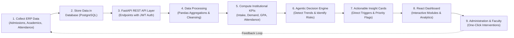

# Agentic AI Institutional Decision Engine - ICFAI Tech School

[](https://reactjs.org/)
[](https://www.typescriptlang.org/)
[](https://tailwindcss.com/)
[](https://vitejs.dev/)
[](https://fastapi.tiangolo.com/)
[](https://www.postgresql.org/)

An AI-powered decision support system designed specifically for **ICFAI Tech School**. This platform transforms institutional ERP data (Admissions, Academics, Attendance) into actionable insights, automated risk alerts, and interactive performance dashboards for executive leadership, faculty, and administration.

---

## Project Overview

The **Agentic AI Institutional Decision Engine** empowers institutional leaders with data-driven decision-making capabilities. It bridges raw campus data with machine learning analytics and proactive decision pipelines to monitor student intake, identify academic failure risks early, audit mandatory attendance thresholds, and deliver real-time institutional intelligence.

### Key Capabilities
- **Role-Based Authentication**: Custom sign-in matching official ICFAI Tech School branding with **Admin**, **Faculty**, and **Viewer** quick-access demo roles, institutional domain verification, dynamic CAPTCHA challenges, and live user session logging.
- **Executive Command Dashboard**: Responsive layout with deep navy sidebar (`#0A1F44`), academic year filters (`2023 - 2025`), global search, notification counters, and modular views.
- **Agentic AI Decision Engine**: Streamlined insight cards categorized across Admissions, Attendance, Academics, NPTEL/Internships, and Placements. Features priority levels, direct contextual insight summaries, category filtering, and one-click action initiators with real-time status tracking.
- **Admissions Analytics**: Track total application volume, branch demand index, seat allocation rates (1st and 2nd choice), and branch seat utilization with interactive charts.
- **Academic Risk Engine**: Identify students scoring under 40/100 marks before final exams, monitor scholarship eligibility (>8 CGPA), track pass rates, and analyze NPTEL course completions.
- **Attendance Audit & Compliance**: Real-time tracking of overall attendance percentages with automated alerts for students dropping below mandatory **75%** and critical **65%** thresholds.
- **User Activity & Audit Logs**: Live table recording all login sessions (email, role, timestamp, status, device) with database backend schema integration.
- **Security & Password Management**: Self-service password management with role-aware security controls and role badge display.

---

## Tech Stack

### Frontend Application
- **Framework**: [React.js 18](https://reactjs.org/) + [TypeScript](https://www.typescriptlang.org/)
- **Build Tool**: [Vite 5](https://vitejs.dev/)
- **Styling**: [Tailwind CSS](https://tailwindcss.com/) + [PostCSS](https://postcss.org/)
- **Icons**: [Lucide React](https://lucide.dev/)
- **Charts**: [Recharts](https://recharts.org/)
- **Routing**: [React Router DOM v6](https://reactrouter.com/)

### Backend & Database Architecture
- **Backend Framework**: [FastAPI](https://fastapi.tiangolo.com/) (Python)
- **ORM & Validation**: SQLAlchemy + Pydantic
- **Authentication**: JWT (JSON Web Tokens) + Role-Based Access Control (RBAC)
- **ASGI Server**: Uvicorn
- **Database**: [PostgreSQL](https://www.postgresql.org/) / SQLite (Development)

### AI & Analytics Pipeline
- **Data Analytics**: Python (Pandas, NumPy, Scikit-learn)
- **Agentic Intelligence**: Rule-based triggers & ML models for proactive risk detection and automated institutional interventions

---

## End-to-End System Workflow



1. **ERP Data Collection**: Collect raw records across Admissions, Academics, Attendance, and Placements.
2. **Database Persistence**: Ingest and structure historical and transactional data in PostgreSQL.
3. **FastAPI API Layer**: Expose secure JWT-authenticated REST endpoints for frontend data consumption.
4. **Data Cleansing & Aggregation**: Aggregate metrics, calculate moving averages, and clean data frames.
5. **KPI Computation**: Compute admission intake rates, seat utilization, student GPAs, and attendance compliance.
6. **Agentic Decision Engine**: Detect patterns, capacity saturation, low attendance, and course academic risks.
7. **Actionable Insight Cards**: Present concise, distraction-free cards with priority badges and direct context.
8. **React Dashboard**: Render real-time metrics, interactive charts, and system status.
9. **Direct Action & Execution**: Faculty and administrators review alerts and execute interventions with instant status feedback.

---

## Key Performance Indicators (KPIs)

| KPI | Module | Description |
| :--- | :--- | :--- |
| **Total Applications** | Admissions | Total student application volume for ICFAI Tech School indicating overall demand. |
| **First Choice Allocation Rate (%)** | Admissions | Percentage of students allocated to their 1st preferred engineering branch. |
| **Second Choice Allocation Rate (%)** | Admissions | Percentage of students allocated to their 2nd preferred branch. |
| **Seat Utilization Rate (%)** | Admissions | Percentage of total available seats filled across all engineering departments. |
| **Branch Demand Index** | Admissions | Departmental demand based on student first-choice preferences. |
| **Overall Attendance (%)** | Attendance | Average institutional attendance percentage across all enrolled students. |
| **Students Below 75% Attendance** | Attendance | Total number of students below the mandatory 75% attendance threshold. |
| **Students Below 65% Attendance** | Attendance | Total number of students below critical 65% attendance requiring immediate warning. |
| **Students at Risk of Failure (<40 Marks)** | Academics | Students scoring below 40/100 requiring academic remediation. |
| **Scholarship-Eligible Students (>8 CGPA)** | Academics | Percentage of high-performing students eligible for merit scholarships. |
| **NPTEL Course Participation (%)** | Academics | Percentage of students enrolled in or completing NPTEL certifications. |
| **Internship Participation (%)** | Academics | Percentage of students undertaking industrial internships. |
| **Placement After Internship (%)** | Academics | Percentage of students who secure placement after completing an internship. |

---

## Agentic AI Decision Engine

The **Agentic AI Decision Engine** continuously audits institutional data across Admissions, Academics, Attendance, and Placements to automatically generate proactive insight cards for leadership and faculty.

### Streamlined Card Architecture
To maximize clarity and reduce visual clutter, each insight card is designed with a focused, intuitive layout:
- **Category Badge & Priority Indicator**: Dynamic color-coded tags reflecting the institutional domain (**Admissions**, **Attendance**, **Academics**, **NPTEL/Internship**, **Placement**) and priority level (**High**, **Medium**, **Low**, **Informational**).
- **Insight Title**: Clear, bold headline stating the core institutional finding (e.g., *Increase CSE Seat Intake*, *Attendance Intervention Alert*, *Schedule Remedial Classes*).
- **Context Information Box**: A clean, tinted card displaying the direct rationale and trigger data without redundant section headers or extra clutter.
- **Action Trigger & Status Tracking**: One-click action button (e.g., *Review Intake*, *Send Alerts*, *Schedule Remedials*, *Run Workshops*, *Expand Hiring*) with real-time status toggle (`Status: Pending` ⇄ `Status: Action Initiated`) and toast confirmation.
- **Category Filtering**: Top filter chips allow instant filtering by department (`All`, `Admissions`, `Attendance`, `Academics`, `NPTEL/Internship`, `Placement`).

---

## Project Structure

```
agentic-ai-sp/
├── App.tsx                     # Main React Router setup (LoginPage & DashboardPage routes)
├── AuthContext.tsx             # Global authentication context & login session audit tracking
├── DashboardPage.tsx           # Executive command center, navigation, header & Agentic AI Decision Engine
├── AdmissionsModuleView        # Admissions analytics & branch preference visualizer (in DashboardPage)
├── AcademicsPage.tsx           # Course grades, pass rates, risk analytics & student performance
├── AttendancePage.tsx          # Real-time attendance compliance, warning lists & department tracking
├── ApplicationsByYearChart.tsx # Historical application trends and distribution bar chart
├── SeatsByBranchChart.tsx      # Seat allocation and department capacity analytics
├── LoginPage.tsx               # ICFAI Tech School branded authentication page with domain validation & CAPTCHA
├── main.tsx                    # React application entry point
├── index.css                   # Tailwind base directives & custom font styling
├── index.html                  # HTML entry point with Google Fonts
├── tailwind.config.js          # Custom Tailwind design system tokens
├── vite.config.ts              # Vite dev server configuration (Port 3000, API proxy to 8000)
├── tsconfig.json               # TypeScript compiler configuration
├── package.json                # Project dependencies and npm scripts
│
├── backend/                    # FastAPI backend application
│   ├── main.py                 # FastAPI application root, CORS & router aggregation
│   ├── auth_api.py             # User authentication, JWT issuance & session logging
│   ├── attendance_api.py       # Attendance tracking, statistics & compliance endpoints
│   ├── academics_api.py        # Academics analytics, score distributions & risk endpoints
│   ├── capacity_config.py      # Department seat capacity configurations
│   ├── database.py             # Database session manager & connection pool
│   ├── models.py               # SQLAlchemy ORM models (Users, Students, Applications, Logs)
│   └── seed_data.py            # Initial dataset seeding script
└── README.md                   # Project documentation
```

---

## Local Development Setup

### Prerequisites
- [Node.js](https://nodejs.org/) (v18.0.0 or higher)
- `npm` (v9.0.0 or higher)
- [Python](https://www.python.org/) 3.10+ (for backend API)

### 1. Frontend Setup

1. **Install Frontend Dependencies**:
   ```bash
   npm install
   ```

2. **Start the Frontend Development Server**:
   ```bash
   npm run dev
   ```

3. **Access the Web Application**:
   Open your browser and navigate to:
   **[http://localhost:3000/](http://localhost:3000/)**

### 2. Backend Setup (Optional / API Services)

1. **Navigate to the Backend Directory & Create a Virtual Environment**:
   ```bash
   cd backend
   python -m venv venv
   # Windows:
   venv\Scripts\activate
   # macOS/Linux:
   source venv/bin/activate
   ```

2. **Install Python Dependencies**:
   ```bash
   pip install fastapi uvicorn sqlalchemy pydantic psycopg2-binary
   ```

3. **Run the FastAPI Server**:
   ```bash
   uvicorn main:app --reload --port 8000
   ```

---

## Authentication & User Activity Tracking

- **Institutional Email Validation**: Restricts access to approved institutional domains (`@icfai.edu`, `@icfai.ac.in`, `@ifheindia.org`, etc.).
- **Dynamic CAPTCHA Verification**: Prevents automated bot access with mathematical verification questions powered by the FastAPI backend.
- **Quick Demo Credentials**: Pre-configured role profiles for **Admin**, **Faculty**, and **Viewer** for instant testing and demonstration.
- **Password Recovery**: Integrated forgot/reset password modal workflow.
- **User Activity Audit Logs**: Navigate to **Settings** in the dashboard to review real-time recorded login sessions (email, role, timestamp, status, device).
- **Password Security**: Access security settings in the dashboard to update credentials with role verification.

---

## License

© 2025 ICFAI Tech School. Academic Project . For Educational Purposes only
